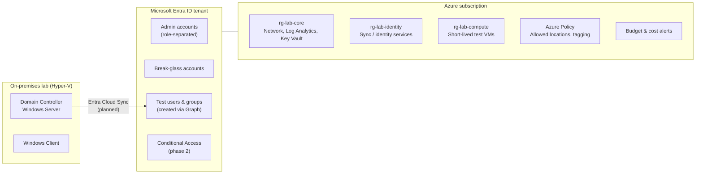

# azure-lab

Personal lab for **Microsoft Azure and Microsoft Entra ID**, focused on hybrid identity, governance, security and automation.

This repository documents how I design, build and operate a small cloud environment the way I would in production: role-separated admin accounts, cost guardrails, consistent naming, policy enforcement, and everything that can be scripted is scripted.

> **Status:** Work in progress. The lab is built step by step alongside my AZ-104 and SC-300 preparation. See the [Roadmap](#roadmap) for current progress.

---

## Background

I have about 10 years of experience running enterprise Microsoft infrastructure in the public sector: Active Directory with a tiered admin model, PKI and smartcard logon, ADFS (SAML/OIDC), MFA/FIDO2, Exchange, SQL Server Always On, VMware vSphere, NetApp MetroCluster and Commvault.

This lab extends that on-premises experience into **cloud and hybrid identity**. It shows how proven enterprise practices carry over to Azure and Entra ID.

---

## Goals

- Build a secure, cost-controlled Azure and Entra ID environment from scratch
- Apply enterprise identity practices: tiered admin model, break-glass accounts, phishing-resistant MFA, least privilege
- Automate identity and resource management with PowerShell, Microsoft Graph and later Terraform
- Connect an on-premises Active Directory to Entra ID (hybrid identity)
- Document architecture decisions so others can reproduce the setup

---

## Lab architecture (planned)



---

## Design decisions

### Identity and access
| Decision | Rationale |
|---|---|
| Separate cloud-only admin account, no daily use of the subscription owner account | Mirrors the tiered admin model from on-premises AD |
| Two break-glass accounts with FIDO2 keys, excluded from Conditional Access | Prevents tenant lockout; follows Microsoft guidance |
| Phishing-resistant MFA (FIDO2/passkeys) preferred over app-based MFA | Aligns with Zero Trust principles |
| Users and groups created via script, not the portal | Repeatable, auditable, easy to reset |

### Governance and cost
| Decision | Rationale |
|---|---|
| Monthly budget with alerts at 50 / 80 / 100 % actual and 100 % forecast | No surprise costs in a personal lab |
| Azure Policy "Allowed locations" | Keeps resources in one region, prevents accidental deployments |
| Mandatory tags: `owner`, `project`, `env`, `autodelete` | Enables cost tracking and safe cleanup |
| Auto-shutdown on all VMs, short-lived compute resource group | Minimises running costs |

### Naming convention
Based on the [Microsoft Cloud Adoption Framework](https://learn.microsoft.com/en-us/azure/cloud-adoption-framework/ready/azure-best-practices/resource-naming):

```
<resource-type>-<workload>-<environment>-<region>
rg-lab-core-swc
kv-lab-core-swc
```

---

## Repository structure (planned)

```
azure-lab/
├── docs/              # Architecture notes, diagrams, decision records
├── scripts/
│   ├── identity/      # Microsoft Graph PowerShell: users, groups, roles
│   └── governance/    # Budgets, policies, tagging
├── data/              # Sample CSV input files (fictional data only)
└── terraform/         # Infrastructure as Code (phase 2)
```

---

## Roadmap

### Phase 1 – Foundation (AZ-104)
- [x] Azure subscription and Entra ID tenant created, MFA enabled
- [ ] Budget and cost alerts
- [ ] Role-separated admin and break-glass accounts
- [ ] Resource groups, tagging and Azure Policy
- [ ] Script: create and remove test users and groups via Microsoft Graph
- [ ] On-premises AD lab (Hyper-V)

### Phase 2 – Hybrid identity and security (SC-300)
- [ ] Entra Cloud Sync / Connect from on-premises AD
- [ ] Migration scenario: ADFS federation to Entra ID cloud authentication
- [ ] Conditional Access baseline with phishing-resistant MFA
- [ ] Privileged Identity Management (PIM) and access reviews

### Phase 3 – Infrastructure as Code
- [ ] Rebuild the core environment with Terraform
- [ ] CI/CD validation with GitHub Actions

---

## Tools

PowerShell 7 · Az PowerShell · Microsoft Graph PowerShell SDK · Azure CLI · Visual Studio Code · Git · Terraform (planned)

---

## Security note

This repository contains **no secrets, tenant IDs, subscription IDs or credentials**. All sample data is fictional. Scripts read sensitive values from environment variables or prompt at runtime.

---

## License

[MIT](LICENSE)
